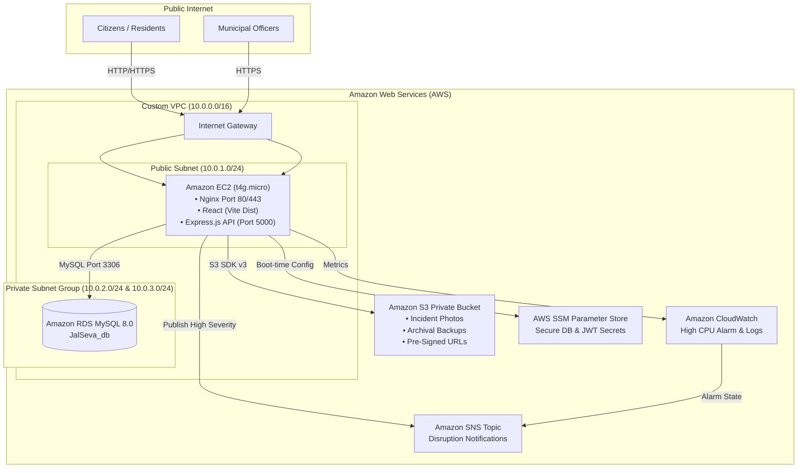

# OFFCAMPUS CODE-  ANXHDG

# JalSeva — Cloud-Based Water Supply Disruption Reporting System

JalSeva is a production-ready, cloud-architected civic-tech platform that empowers citizens to report localized water supply disruptions (pipeline leaks, contamination, low pressure, and complete outages) with photographic evidence, and provides municipal water authorities with a real-time, centralized incident management and tracking dashboard.

---

## 1. Problem Statement

In many municipal regions, citizen water supply complaints are fragmented across disparate telephone hotlines, informal WhatsApp groups, or paper logbooks. This leads to:
- Lack of centralized tracking and accountability.
- Delayed municipal response to critical pipeline ruptures and contaminated drinking water.
- Inability for residents to verify whether an issue has already been reported in their neighborhood.
- No photographic evidence trail for field repair crews.

**JalSeva** solves this by establishing a single cloud-backed incident reporting, verification, and resolution management pipeline.

---

## 2. Technology Stack

- **Frontend**: React.js 18 with Vite
- **Styling**: Modern, responsive CSS design (civic-tech palette: deep navy blue, water blue, clean grey, and white)
- **Charts**: Recharts (Locality and issue category distribution)
- **Icons**: Lucide React
- **Backend**: Node.js with Express.js REST API
- **Database**: MySQL 8.0, designed for Amazon RDS MySQL (includes automatic SQLite fallback for zero-configuration local development)
- **File Storage**: Amazon S3 (with time-limited Pre-Signed URLs and local storage fallback)
- **Authentication**: Stateless JSON Web Tokens (JWT) with bcrypt password hashing
- **Notifications**: Amazon Simple Notification Service (SNS)
- **Cloud Secrets**: AWS Systems Manager (SSM) Parameter Store
- **Monitoring**: Amazon CloudWatch Metrics & Alarms

---

## 3. Key Features

### For Citizens / Residents
- **Streamlined Disruption Reporting**:
  - Locality / Area selection.
  - Category classification: *No Water Supply*, *Low Water Pressure*, *Pipeline Leakage*, *Contaminated Water*, *Other*.
  - Severity level: *Low*, *Medium*, *High*, *Critical*.
  - Detailed description with input validation.
  - Optional photographic evidence upload (JPG, PNG, WEBP up to 5 MB).
- **Instant Incident Reference ID**: Generates an identifiable reference number (e.g. `AQ-906938`).
- **Interactive Disruption Tracker**:
  - Live search by Incident ID or Area keyword.
  - Filter by Status (*Reported*, *Under Review*, *In Progress*, *Resolved*).
  - Filter by Category and Severity.
  - Modal view to inspect administrative resolution updates and citizen photo evidence.

### For Municipal Administrators
- **Secured Management Portal**: JWT-authenticated administrative dashboard protected by rate limiting and bcrypt encryption.
- **Aggregated Analytics & KPIs**:
  - Total reported incidents count.
  - Pending review count.
  - Active field repair counter.
  - Resolved incidents tally.
  - High/Critical priority alerts.
- **Visual Analytics**: Interactive Recharts displaying reports by locality and disruption category.
- **Incident Lifecycle Management**:
  - Inspect citizen uploaded photographs via secure S3 Pre-Signed URLs.
  - Update status progression from *Reported* to *Under Review*, *In Progress*, or *Resolved*.
  - Re-classify severity levels.
  - Publish official resolution notes visible to residents.
- **Archival Export**: One-click S3 JSON backup export for municipal audits.

---

## 4. System Architecture

JalSeva runs on Amazon EC2 hosting both the React client build and Express backend inside a Public Subnet, connecting across VPC boundaries to an Amazon RDS MySQL instance residing strictly within Private Subnets.



---

## 5. Project Directory Structure

```
JalSeva/
├── backend/
│   ├── data/                 # Local SQLite database (when MySQL is offline)
│   ├── sql/
│   │   ├── schema.sql        # MySQL / Amazon RDS schema definitions
│   │   └── seed.sql          # Seed demo records and test data
│   ├── src/
│   │   ├── config/           # Environment and SSM Parameter Store loader
│   │   ├── controllers/      # Incident & Admin business logic controllers
│   │   ├── database/         # MySQL connection pool with automatic local fallback
│   │   ├── middleware/       # JWT admin auth and Multer photo upload filters
│   │   ├── routes/           # REST API route definitions
│   │   ├── services/         # S3 storage, SNS notifications, and backup exports
│   │   └── app.js            # Express server initialization & lifecycle
│   ├── tests/
│   │   └── api.test.js       # Automated end-to-end API test suite
│   ├── uploads/              # Local photo storage directory
│   ├── .env.example          # Sample environment variables template
│   └── package.json          # Backend dependencies and execution scripts
├── frontend/
│   ├── src/
│   │   ├── components/       # Navbar, Footer, Badges, and Modal dialogs
│   │   ├── pages/            # Landing, Report Issue, Tracking, and Admin Dashboard
│   │   ├── services/         # Centralized API fetch client
│   │   ├── App.jsx           # Main layout router
│   │   ├── index.css         # Civic-tech responsive styles
│   │   └── main.jsx          # React DOM entry point
│   ├── index.html            # HTML page root
│   ├── vite.config.js        # Vite configuration with proxy to port 5000
│   └── package.json          # Frontend dependencies (React 18, Lucide, Recharts)
├── aws/
│   ├── architecture.md       # In-depth architectural blueprint and Mermaid diagram
│   ├── iam-policy.json       # Least-privilege IAM policy for EC2 instance profile
│   ├── deployment-guide.md   # Step-by-step AWS Console & CLI deployment walkthrough
│   ├── cloudwatch-guide.md   # CloudWatch CPU alarm and log aggregation setup
│   └── cost-estimation.md    # Itemized monthly AWS cost and Free Tier analysis
├── .gitignore                # Git exclusion rules
└── README.md                 # Complete project documentation
```

---

## 6. Database Schema (MySQL / Amazon RDS)

### `incidents` Table
| Column Name | Data Type | Attributes | Description |
| :--- | :--- | :--- | :--- |
| `id` | `INT` | `PRIMARY KEY AUTO_INCREMENT` | Internal unique row identifier |
| `incident_id` | `VARCHAR(50)` | `NOT NULL UNIQUE` | Human-friendly reference ID (e.g., `AQ-906938`) |
| `area` | `VARCHAR(150)` | `NOT NULL` | Neighborhood / street locality |
| `issue_type` | `VARCHAR(100)` | `NOT NULL` | Disruption category |
| `severity` | `VARCHAR(50)` | `NOT NULL` | Low, Medium, High, or Critical |
| `description` | `TEXT` | `NOT NULL` | Citizen description of the disruption |
| `photo_key` | `VARCHAR(255)` | `NULL` | Private Amazon S3 object key or local path |
| `status` | `VARCHAR(50)` | `DEFAULT 'Reported'` | Reported, Under Review, In Progress, Resolved |
| `resolution_note`| `TEXT` | `NULL` | Official municipal engineer update |
| `created_at` | `TIMESTAMP` | `DEFAULT CURRENT_TIMESTAMP` | Submission timestamp |
| `updated_at` | `TIMESTAMP` | `ON UPDATE CURRENT_TIMESTAMP` | Last modification timestamp |

### `admin_users` Table
| Column Name | Data Type | Attributes | Description |
| :--- | :--- | :--- | :--- |
| `id` | `INT` | `PRIMARY KEY AUTO_INCREMENT` | Internal admin ID |
| `username` | `VARCHAR(50)` | `NOT NULL UNIQUE` | Admin username (default: `admin`) |
| `email` | `VARCHAR(150)` | `NOT NULL UNIQUE` | Administrative email |
| `password_hash`| `VARCHAR(255)`| `NOT NULL` | Bcrypt hashed password (cost factor 10) |
| `created_at` | `TIMESTAMP` | `DEFAULT CURRENT_TIMESTAMP` | Account creation timestamp |

---

## 7. REST API Endpoints

| Method | Endpoint | Access | Description |
| :--- | :--- | :--- | :--- |
| `GET` | `/api/health` | Public | Service health check, database status, and cloud flags |
| `POST`| `/api/incidents` | Public | Submit new disruption report with optional photo evidence |
| `GET` | `/api/incidents` | Public | Query incidents with filters (`status`, `issue_type`, `severity`, `search`) |
| `GET` | `/api/incidents/:id`| Public | Fetch detailed record by incident reference ID |
| `POST`| `/api/admin/login` | Public (Rate-limited)| Authenticate administrator and receive signed JWT |
| `GET` | `/api/admin/dashboard`| Protected (JWT) | Aggregated KPI stats, category distributions, and recent reports |
| `PATCH`| `/api/admin/incidents/:id`| Protected (JWT) | Update status, severity, and publish resolution notes |
| `POST`| `/api/admin/backup` | Protected (JWT) | Trigger on-demand archival backup to Amazon S3 |

---

## 8. Local Setup & Quickstart

### Prerequisites
- Node.js v18+ or v20+
- npm v9+

### 1. Clone & Configure Backend
```bash
cd JalSeva/backend
npm install
cp .env.example .env
```
*(By default, the backend runs with local SQLite storage fallback and local disk uploads. You do not even need MySQL installed locally to test the complete application! When connecting to Amazon RDS, simply supply your RDS endpoint in `.env`).*

### 2. Run Automated API Test Suite
```bash
npm test
```
*Executes all 13 integration tests verifying incident creation, ID generation, JWT auth, dashboard aggregations, status updates, and route protections.*

### 3. Start Backend Server
```bash
npm start
# Server listens on http://localhost:5000
```

### 4. Start Frontend Development Server
In a separate terminal:
```bash
cd JalSeva/frontend
npm install
npm run dev
# Frontend runs at http://localhost:3000
```
Open your browser and visit: **`http://localhost:3000`**

### Demo Admin Credentials
- **Username**: `admin`
- **Password**: `Admin@123`

---

## 9. AWS Cloud Deployment Checklist

For complete step-by-step console instructions, refer to [`aws/deployment-guide.md`](aws/deployment-guide.md).

- [x] **VPC**: 1 Public Subnet (EC2), 2 Private Subnets (RDS Multi-AZ Subnet Group)
- [x] **EC2 Security Group**: Ports 80, 443 open to internet; port 22 restricted to admin IP
- [x] **RDS Security Group**: Port 3306 strictly restricted to EC2 Security Group ID
- [x] **Amazon RDS**: MySQL 8.0 `db.t4g.micro` or `db.t3.micro` Single-AZ with automated 7-day backups
- [x] **Amazon S3**: Private bucket with Block Public Access enabled and CORS configured
- [x] **IAM Role**: Attached to EC2 with least-privilege permissions (`aws/iam-policy.json`)
- [x] **SSM Parameter Store**: SecureStrings stored for `/JalSeva/prod/db/password` and `/JalSeva/prod/jwt/secret`
- [x] **Amazon SNS**: Topic `JalSeva-Incidents-Topic` with confirmed email subscriptions
- [x] **CloudWatch**: High CPU alarm (> 80% for 5 min) triggering SNS alert ([`aws/cloudwatch-guide.md`](aws/cloudwatch-guide.md))
- [x] **AWS Budgets**: Configured at $10.00/month limit for zero-cost surprises ([`aws/cost-estimation.md`](aws/cost-estimation.md))

---

## 10. Cost & Security Considerations

- **Cost Consciousness**: Total estimated monthly cost on AWS Free Tier is **$0.00**. Outside free tier, the architecture remains under **$22.20/month** by avoiding expensive NAT Gateways ($32/mo) and multi-AZ database surcharges.
- **Strict Private S3 Storage**: Incident photos are never uploaded with public read permissions. Citizen and administrator browsers view images strictly through backend-generated time-expiring Pre-Signed URLs.
- **Defense in Depth**: Database has no public IP address and cannot be accessed from the outside internet.

